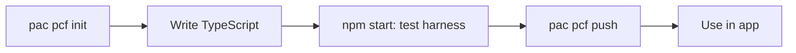

<div align="center">

# 🧱 Power Platform PCF Controls

**Custom code components built with the Power Apps Component Framework.**


</div>

---

## ✨ What's Inside

| 📁 Folder | 📝 Contents |
|---|---|
| `controls/` | One folder per PCF control |
| `docs/` | Setup guides and screenshots |
| `solutions/` | Solution wrappers for deployment |

## 🛠️ Prerequisites

- [Node.js](https://nodejs.org) (LTS)
- [Power Platform CLI](https://learn.microsoft.com/power-platform/developer/cli/introduction) (`pac`)
- VS Code

## 🔄 Build Flow



## 🚀 Quick Start

```bash
pac pcf init --namespace Demo --name MyControl --template field
npm install
npm start
```

## 🗺️ Roadmap

- [x] Create repository
- [ ] Scaffold first control
- [ ] Add manifest and TypeScript logic
- [ ] Add styling
- [ ] Package as a solution
- [ ] Add screenshots

> 🔒 All samples are sanitized: no client data, tenant IDs, or secrets.

---

<div align="center">

Built by **[Bharadwaj Vemula](https://github.com/bharadwaj-vemula)** · Microsoft Power Platform Developer

</div>
