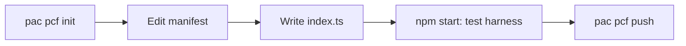

<div align="center">

# 🧱 Scaffold Your First PCF Control

**From an empty folder to a working control in the test harness.**


</div>

---

## 🛠️ Before You Start

- Node.js (LTS)
- Power Platform CLI (`pac`)
- VS Code

Check your setup:

```bash
node --version
pac help
```

## 🔄 The Flow



## 🚀 Step 1: Scaffold

Run this inside the `controls/` folder:

```bash
mkdir HelloControl
cd HelloControl
pac pcf init --namespace Demo --name HelloControl --template field --run-npm-install
```

| Option | Meaning |
|---|---|
| `--namespace` | Groups your controls, for example `Demo` |
| `--name` | Name of the control |
| `--template` | `field` for a single column, `dataset` for a table or grid |
| `--run-npm-install` | Installs dependencies right away |

## 📁 What You Get

```
HelloControl/
├── HelloControl/
│   ├── ControlManifest.Input.xml   # Control definition and properties
│   └── index.ts                    # Control logic
├── package.json
├── tsconfig.json
└── pcfconfig.json
```

## 🧬 The Four Lifecycle Methods

In `index.ts`:

| Method | Runs when |
|---|---|
| `init` | The control first loads |
| `updateView` | Any input or data changes |
| `getOutputs` | The control sends a value back to the app |
| `destroy` | The control is removed |

## 🧪 Step 2: Run the Test Harness

```bash
npm start watch
```

A browser opens with your control. Edit `index.ts`, save, and the harness reloads.

## 🏗️ Step 3: Build

```bash
npm run build
```

Fix any TypeScript errors before moving on.

## ☁️ Step 4: Push to a Dev Environment

```bash
pac auth create --url https://YOUR-DEV-ENV.crm.dynamics.com
pac pcf push --publisher-prefix bhv
```

This deploys the control to your Dev environment so you can add it to an app.

> 🔒 Use a Dev environment only, and never commit environment URLs, secrets, or tenant IDs.

## 🙈 Keep Git Clean

Add a `.gitignore` containing:

```
node_modules/
out/
obj/
bin/
generated/
```

## 📋 Checklist

- [ ] Control scaffolded with the correct template
- [ ] Manifest properties defined
- [ ] Works in the test harness
- [ ] `npm run build` passes
- [ ] `.gitignore` excludes `node_modules` and build output
- [ ] Screenshot added to `docs/images/`

---

<div align="center">

Built by **[Bharadwaj Vemula](https://github.com/bharadwaj-vemula)** · Microsoft Power Platform Developer

</div>
